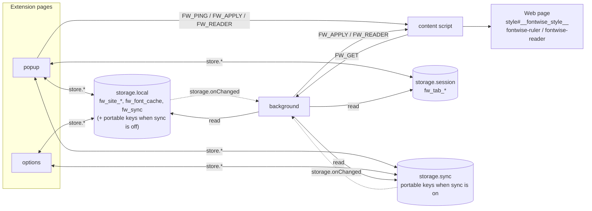
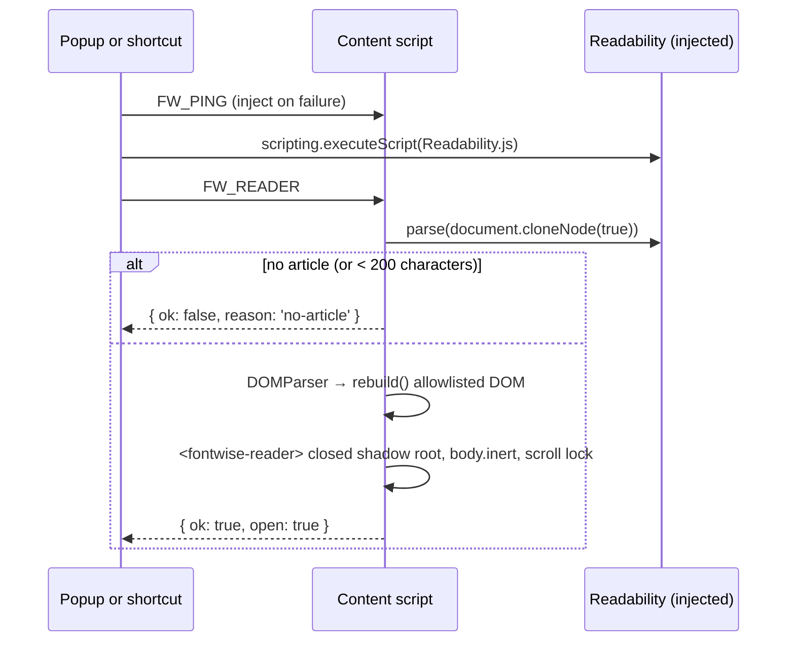

# Architecture: how Fontwise works

This document describes the parts of the extension, how data flows between them, and why the main design decisions were made. For installation and usage see the [README](../README.md).

---

## 1. Overview

The extension in [`extension/`](../extension) is plain HTML/CSS/JavaScript with no build step and no runtime dependencies. Shared logic lives in classic scripts under `shared/` that attach to one global namespace, `globalThis.Fontwise`. Each file is wrapped in an IIFE, so re-injecting it is harmless.

| Module                          | Exposes                                                                                                                                                                            | Used by                    |
| ------------------------------- | ---------------------------------------------------------------------------------------------------------------------------------------------------------------------------------- | -------------------------- |
| `shared/settings.js`            | `LIMITS`, `CHOICES`, `DEFAULT_SETTINGS`, `DEFAULT_PREFS`, `THEMES`, `PRESETS`, `sanitize*`, `resolve`, `siteKey`, `isNight`, `msUntilNightChange`, contrast helpers, `buildPreset` | everything                 |
| `shared/css.js`                 | `buildCss`, `fontFaceCss`, `readerCss`                                                                                                                                             | content script, popup      |
| `shared/catalog.js`             | `FONT_CATALOG`, `SYSTEM_FONTS`, `FONT_CATEGORIES`, `CATALOG_VERSION`, `detectInstalledFonts`, `availableFonts`                                                                     | popup, background          |
| `shared/bundled-fonts.js`       | `BUNDLED_FONTS` (generated by `npm run vendor`)                                                                                                                                    | content script, popup      |
| `shared/store.js`               | `KEY`, `CONTENT_SCRIPTS`, `store.*` (layers, presets, sync, backup, font cache, messaging, badge)                                                                                  | popup, options, background |
| `shared/i18n.js`                | `t`, `localize`, `themeLabel`, `describeSettings`, `commandLabel`                                                                                                                  | popup, options, welcome    |
| `shared/ui.js`                  | `roving` (arrow-key navigation), `setTabStop`, `announce`                                                                                                                          | popup                      |
| `shared/tokens.css`, `page.css` | design tokens (light, dark, forced colours, reduced motion); full-page layout                                                                                                      | popup, options, welcome    |

| Context            | Files                                                          | Lifetime                                        | Responsibility                                                                                       |
| ------------------ | -------------------------------------------------------------- | ----------------------------------------------- | ---------------------------------------------------------------------------------------------------- |
| **Popup**          | `popup/*`                                                      | While open                                      | Detect fonts, edit one settings layer, preview live, persist                                         |
| **Options**        | `options/*`                                                    | While open                                      | Preferences, sync, sites, presets, shortcuts, backup                                                 |
| **Welcome**        | `welcome/*`                                                    | Opened once on install                          | Onboarding                                                                                           |
| **Content script** | `shared/{bundled-fonts,settings,css}.js`, `scripts/content.js` | One per page (top frame), from `document_start` | Validate, build CSS, one `<style>` element, ruler, Focus mode, automatic dark                        |
| **Background**     | `shared/{settings,catalog,store}.js`, `scripts/background.js`  | Event-driven (service worker / event page)      | Answer `FW_GET`, badge, update open tabs when shared layers change, shortcuts, install/update events |



### Cross-browser approach

One `manifest.json` serves every browser:

| Key                               | Chromium                                      | Firefox                                                                     |
| --------------------------------- | --------------------------------------------- | --------------------------------------------------------------------------- |
| `background.service_worker`       | used; loads shared files with `importScripts` | ignored (warning `BACKGROUND_SERVICE_WORKER_IGNORED`)                       |
| `background.scripts`              | ignored (Chrome 121+)                         | used (event page); lists the shared files before `background.js`            |
| `minimum_chrome_version`          | `121`                                         | ignored                                                                     |
| `browser_specific_settings.gecko` | ignored                                       | add-on id, `strict_min_version: 140.0`, `data_collection_permissions: none` |
| `commands`                        | 4 commands (Chrome's suggested-key maximum)   | same; none on Android                                                       |

Every script uses `const ext = globalThis.browser ?? globalThis.chrome;` and only promise-returning APIs. `runtime.onMessage` listeners reply with `sendResponse` + `return true`, because Chrome ignores a promise returned from the listener. Optional APIs are feature-tested: `tabs.onReplaced?`, `commands.openShortcutSettings` (Firefox 137+), and `commands?` (absent on Android).

---

## 2. Data model

### 2.1 Settings

The same shape is used for every scope and preset. `null` means *keep the page's own value*.

| Key                                 | Type           | Allowed values                                      | Default |
| ----------------------------------- | -------------- | --------------------------------------------------- | ------- |
| `enabled`                           | boolean        | master switch                                       | `true`  |
| `font`                              | object \| null | `{ id, name, stack, category }` from the catalogue  | `null`  |
| `fontSize`                          | number \| null | 12–28 (px)                                          | `null`  |
| `lineHeight`                        | number \| null | 1–2.5 (unitless)                                    | `null`  |
| `letterSpacing`                     | number \| null | 0–0.15 (em)                                         | `null`  |
| `wordSpacing`                       | number \| null | 0–0.4 (em)                                          | `null`  |
| `paragraphSpacing`                  | number \| null | 0–3 (em)                                            | `null`  |
| `fontWeight`                        | number \| null | 300, 400, 500, 600, 700                             | `null`  |
| `fontStyle`                         | string \| null | `normal`, `italic`                                  | `null`  |
| `theme`                             | string \| null | `light`, `sepia`, `dark`, `contrast`, `custom`      | `null`  |
| `textColor`, `bgColor`, `linkColor` | string \| null | `#rrggbb`                                           | `null`  |
| `lineLength`                        | number \| null | 45–100 (`ch`, max width of paragraph-like elements) | `null`  |
| `marginWidth`                       | number \| null | 0–25 (% of page width, as `body` side padding)      | `null`  |
| `textAlign`                         | string \| null | `left`, `justify`                                   | `null`  |
| `readingRuler`                      | boolean        | draw the reading ruler                              | `false` |
| `keepCodeMono`                      | boolean        | keep `pre`/`code`/editors in their own font         | `true`  |

`sanitizeSettings()` is the single gate: it clamps numbers, checks enumerations and colours, and validates the font stack. It runs on every read from storage, every message and every import. A layer whose settings have no overrides is deleted rather than stored.

### 2.2 Storage keys

| Key              | Area                   | Shape                                                                                       |
| ---------------- | ---------------------- | ------------------------------------------------------------------------------------------- |
| `fw_tab_{tabId}` | `session`              | settings                                                                                    |
| `fw_site_{host}` | `local` (never synced) | settings; host without `www.`                                                               |
| `fw_global`      | portable               | settings (*Everywhere*)                                                                     |
| `fw_prefs`       | portable               | `{ defaultScope, autoDark: { mode, start, end } }`                                          |
| `fw_excluded`    | portable               | `string[]` of host names                                                                    |
| `fw_preset_{id}` | portable               | `{ id, name, settings, createdAt }`, one key per preset to stay under sync's per-item quota |
| `fw_sync`        | `local`                | `boolean`; selects the portable area                                                        |
| `fw_font_cache`  | `local`                | `{ catalogVersion, installedIds[], scannedAt }`                                             |

The *portable* area is `storage.sync` when `fw_sync` is true, otherwise `storage.local`. `store.setSync()` copies the portable keys to the other area (keeping data already there) and removes them from `local` when sync is turned on.

### 2.3 Resolution

```
effective = tab ?? site ?? (excluded ? null : global)
```

`store.layers(tab)` reads the three layers; `resolve()` picks one and reports its scope. The popup edits that scope (or the default scope when nothing is set). `store.defaultScope()` falls back from *site* to *tab* in private windows and on pages without a host. `store.moveTo(scope)` writes the settings to a broader scope and removes the narrower layers for that page, which would otherwise shadow it.

### 2.4 Messages

| Type        | Direction                  | Payload                  | Reply                                                   |
| ----------- | -------------------------- | ------------------------ | ------------------------------------------------------- |
| `FW_GET`    | content → background       | —                        | `{ settings, autoDark }` or `null`                      |
| `FW_PING`   | popup/background → content | —                        | `true`                                                  |
| `FW_APPLY`  | popup/background → content | `{ settings, autoDark }` | `true`                                                  |
| `FW_READER` | popup/background → content | `{ notify }`             | `{ ok, open }` or `{ ok: false, reason: 'no-article' }` |

`store.send()` tries `tabs.sendMessage`. If no content script answers (the tab was open before install or update), it injects `CONTENT_SCRIPTS` and retries. A unit test keeps `CONTENT_SCRIPTS` equal to the manifest list.

---

## 3. Flows

### 3.1 Editing in the popup

```mermaid
sequenceDiagram
    participant P as Popup
    participant S as Storage
    participant C as Content script

    P->>S: prefs, font cache, presets, layers(tab)
    P->>P: resolve → settings + scope; render
    P->>C: FW_PING (inject on failure)
    loop every change
        P->>P: update(patch) → re-render in place
        P->>C: FW_APPLY (throttled 50 ms, ordered chain)
        P->>S: write(scope) (debounced 250 ms, 1 s with sync)
    end
    Note over P: pagehide / visibilitychange flush the pending write
```

Live preview and persistence are separate: the page updates every 50 ms while you drag a slider, but storage is written only after a pause. This keeps `storage.sync` under its write quota (about 120 writes a minute).

### 3.2 Page load

The content script runs at `document_start` and sends `FW_GET`. The background resolves the layers for `sender.tab`, replies with `{ settings, autoDark }` and sets the badge. If the popup's `FW_APPLY` arrives first, the late reply is ignored. On `DOMContentLoaded` the style element is re-appended so it comes after the page's own stylesheets. Pages restored from the back/forward cache (`pageshow` with `persisted`) ask again.

### 3.3 Shared layers change

`storage.onChanged` in the background watches `fw_global`, `fw_site_*`, `fw_excluded`, `fw_prefs` and `fw_sync` (session changes are ignored). After a 150 ms debounce, it takes one `store.snapshot()`, resolves every open `http(s)` tab in memory and sends `FW_APPLY`. Tabs with settings get the content script injected if needed; others are only messaged. The same broadcast runs after an extension update, because the old content scripts are orphaned.

### 3.4 Focus mode



Readability is injected only on demand, so pages pay nothing for it. When a shortcut fails, `notify: true` shows a short on-page toast (a `role="status"` region).

### 3.5 Closing a tab

`tabs.onRemoved` removes `fw_tab_{tabId}`. `tabs.onReplaced` (Chrome prerendering) moves it to the new tab id. The browser clears session storage when it quits.

---

## 4. Fonts

### 4.1 Detection

Browsers have no portable API for listing installed fonts, so Fontwise uses the canvas width test:

1. Measure a sample string at 72 px in `monospace`, `serif` and `sans-serif`.
2. Measure `72px "Candidate", <generic>` for each generic.
3. If any width differs from its baseline, the font is installed.

Each entry has a `script`; the sample text matches it (Latin, CJK, Arabic, Devanagari or Hebrew), so a CJK font is detected by how it renders CJK. Each entry can list several detection names (`detect`), for example `Palatino Linotype` and `Palatino`. The popup must not load any web font under a catalogue name, because that would fool detection.

### 4.2 Built-in fonts

`npm run vendor` copies WOFF2 files (Latin and Latin Extended subsets) and the OFL licence from the `@fontsource` packages into `extension/fonts/`, and generates `shared/bundled-fonts.js`. They are registered as **`Fontwise <Name>`** families, so they never clash with installed copies or fool detection. Catalogue entries with `bundled` append that family to their stack, after the installed names, and are always available.

`fonts/*` is a web-accessible resource. `buildCss()` emits `@font-face` rules only for bundled families that the chosen stack actually references, with `font-display: swap` and `unicode-range`, so a page downloads only the faces it renders. `@font-face` is ignored inside shadow roots, so the reader's faces are emitted into the page stylesheet.

### 4.3 Catalogue

`FONT_CATALOG` has 88 entries:
- Sans-serif: 26 Latin and 15 non-Latin, including the bundled Atkinson Hyperlegible, Lexend and OpenDyslexic.
- Serif: 21 Latin (including the bundled Literata) and 8 non-Latin.
- Mono: 18.

`SYSTEM_FONTS` adds System Sans, System Serif and System Mono. Bump `CATALOG_VERSION` whenever the catalogue changes so cached detection results are refreshed.

---

## 5. CSS generation (`shared/css.js`)

All rules use `!important` and are prefixed with `:root`, so they win over typical page rules. Rules are emitted only for settings that are set.

| Setting                                                  | Selector                                                                                               | Declarations                                                                |
| -------------------------------------------------------- | ------------------------------------------------------------------------------------------------------ | --------------------------------------------------------------------------- |
| `font`                                                   | `body`, `body *` except icons (and code when `keepCodeMono`)                                           | `font-family` (+ `@font-face` for bundled families)                         |
| `fontSize`, `lineHeight`, `letterSpacing`, `wordSpacing` | `body, p, li, dd, dt, blockquote, figcaption, td, th, article, section, main, label, summary, caption` | `font-size` (px), `line-height`, `letter-spacing` (em), `word-spacing` (em) |
| `fontWeight`, `fontStyle`                                | same minus `th`, `label`, `summary`, `caption`                                                         | `font-weight`, `font-style`                                                 |
| `paragraphSpacing`                                       | `p`                                                                                                    | `margin-bottom` (em)                                                        |
| `lineLength`                                             | `p, li, dd, dt, blockquote, figcaption`                                                                | `max-width` (ch)                                                            |
| `textAlign`                                              | `p, li, dd, dt, blockquote, figcaption`                                                                | `text-align: start` or `justify` + `hyphens: auto`                          |
| `marginWidth`                                            | `body`                                                                                                 | `padding-inline` (%), `box-sizing: border-box`                              |
| `bgColor` / `textColor` / `linkColor`                    | `html`, `body`, `body *` except media; `a[href]`                                                       | `background-color`, `color`; underline links when only text colour is set   |

**Context options:**
- `forcedColors`: colour rules are skipped, so the operating system's high-contrast palette wins.
- `night`: themes other than dark and contrast are swapped for dark colours.

The content script passes both from `matchMedia` and `isNight()`. It schedules one timer for the next scheduled boundary (`msUntilNightChange`) instead of polling.

**Exclusions:**
- **Icons:** `svg`, `math`, empty elements, `i[class]`, `[class*="icon" i]`, `[class*="glyph" i]`, Material Icons and Symbols, Font Awesome, Bootstrap Icons, Remix, Codicons and `[data-icon]`.
- **Code:** `pre`, `code`, `kbd`, `samp` and `tt`, plus the Monaco, CodeMirror and Ace editors.
- **Media and Fontwise's own hosts:** `img`, `video`, `picture`, `canvas`, `svg`, `iframe`, `embed`, `object`, `fontwise-ruler`, `fontwise-reader` and `fontwise-toast`.

**Validation:**
- **Numbers:** finite and clamped.
- **Colours:** `/^#[0-9a-f]{6}$/i`.
- **Font stack:** `/^[\w\s"',.-]+$/` and at most 600 characters.
- **Enumerations:** allow-lists.

Invalid values are dropped as if unset.

---

## 6. Overlays

All overlays are custom elements appended to `<html>`, with a **closed** shadow root and inline `!important` host styles (`all: initial`, `position: fixed`, maximum `z-index`), so page CSS cannot reach them.

- **Reading ruler:** one band whose `box-shadow` dims the rest of the viewport. It moves with `transform` at most once per animation frame (compositor-only), follows `focusin` for keyboard users, has `pointer-events: none`, `aria-hidden` and `contain: strict`, and adds no listeners when off.
- **Focus mode:**
  - It is a `role="dialog"` with `aria-modal` and a labelled title. While it is open, `document.body` is `inert` and `<html>` scrolling is locked; both are restored on close. The previous values are stored on the host, so a re-injected script can restore them too.
  - <kbd>Esc</kbd> closes it, and focus returns to where it was. Keystrokes are stopped at the host, so page shortcuts do not fire.
  - **Security:** Readability's HTML is parsed by `DOMParser` (no browsing context) and **rebuilt** with `createElement`. Only allowlisted tags and attributes survive. URLs must be `http(s)` (or `mailto:` for links, safe raster `data:` URLs for images). Links open in a new tab with `noopener`. Nodes are never moved from the parsed document: in Chromium, a removed `on*` attribute can still fire after adoption, which the end-to-end suite verifies.
- **Toast:** a `role="status"` message for shortcut feedback, removed after 3.5 s.

---

## 7. Content script lifecycle and performance

- Nothing is created until settings arrive. `matchMedia` listeners, the night timer and ruler listeners exist only while needed.
- CSS is rebuilt only when it changes; the `<style>` element is touched only when the text differs.
- `visibilitychange` re-renders when a tab becomes visible, catching a night boundary missed while hidden.
- **Re-injection and updates:** `Fontwise.contentTeardown()` removes the previous copy's listeners and overlays. When the extension is updated or removed, `runtime.id` becomes undefined and the orphaned copy tears itself down, leaving the page as it is.
- **Non-HTML documents:** XML and SVG are skipped.

---

## 8. Extension pages

- **Localisation:** every string comes from `_locales/en/messages.json` through `data-i18n*` attributes or `t()`; `localize()` also sets `lang` and `dir`. A unit test fails if a referenced key is missing.
- **Keyboard:**
  - **Roving tab stops:** `roving()` gives each group one tab stop. Arrow keys follow the reading direction (mirrored in right-to-left layouts), <kbd>Home</kbd> and <kbd>End</kbd> jump to the ends, and the font grid moves by row. Font selection updates in place, so focus is never lost.
  - **Search:** <kbd>/</kbd> focuses search, <kbd>↓</kbd> moves into the results and <kbd>Esc</kbd> clears.
  - **Options page:** a skip link, native radio groups and fieldsets, and focus kept on a sensible neighbour after deleting a list item.
- **Screen readers:**
  - `announce()` writes to a polite `#status` region (applied presets, search counts, scope and reset results).
  - Sliders expose `aria-valuetext`; toggles use `aria-pressed`; the scope selector and category filter are radio groups; the views form a tablist.
  - The contrast check is plain text.
- **Theming:** `tokens.css` defines dark (default) and light (`prefers-color-scheme`) palettes, forced-colours overrides (state shown with outlines, not just colour), and a global `prefers-reduced-motion` switch. Transitions use only `opacity`, `translate`, `scale` and colour.
- **Responsive:** the popup is 360 × 600 px on desktop and full screen on touch devices (Firefox for Android). Pages use a fluid single column.
- **Failure handling:**
  - Storage writes report failures (for example a full sync quota) instead of failing silently. A failed sync switch is rolled back.
  - Imports are limited to 1 MB and fully re-validated.
  - Restricted pages show a notice and make the controls inert; *Allow access* requests host permission inside the user gesture.

---

## 9. Design decisions and trade-offs

| Decision                                           | Alternatives considered         | Reason                                                                                                       |
| -------------------------------------------------- | ------------------------------- | ------------------------------------------------------------------------------------------------------------ |
| One source folder, one manifest                    | Separate Chrome/Firefox builds  | One source; `tools/build.mjs` only strips `background.scripts` (rejected by Edge) for the Chromium zip.                                           |
| Three scopes (tab, site, everywhere)               | Per-tab only; global only       | Matches how people read: one-off, favourite sites, everywhere. Narrowest wins, so overrides are predictable. |
| Site settings local-only, never in private windows | Sync everything                 | Host names are browsing history; they stay on the device.                                                    |
| Content script asks the background (`FW_GET`)      | Read `storage.session` directly | Content scripts cannot read session storage by default.                                                      |
| Bundled fonts under unique family names            | Ship nothing; use Google Fonts  | Works offline, with no network requests, and does not fool installed-font detection.                         |
| Readability injected on demand                     | Bundle it in the content script | ~90 KB that most pages never need.                                                                           |
| Rebuild the reader DOM from an allowlist           | Strip attributes and move nodes | Proven unsafe in Chromium (see §6).                                                                          |
| Shared IIFE modules on `globalThis.Fontwise`       | ES modules; bundler             | Content scripts and Firefox event pages cannot use ES modules portably; no build step.                       |
| `document_start`, top frame only                   | `document_idle`; all frames     | Re-applies early; avoids restyling ads and widgets.                                                          |
| Firefox minimum 140                                | 121                             | Current ESR; first version that understands `data_collection_permissions`.                                   |

---

## 10. Testing

| Suite                  | Runner                                          | Covers                                                                                                                                                                                                                 |
| ---------------------- | ----------------------------------------------- | ---------------------------------------------------------------------------------------------------------------------------------------------------------------------------------------------------------------------- |
| `tests/unit/*.test.js` | `node --test` + `node:vm`                       | Validation and CSS injection resistance, CSS output, resolution, night schedule, contrast, presets, storage layers, sync migration, import validation, catalogue integrity, manifest consistency and i18n key coverage |
| `tests/e2e/*.spec.js`  | Playwright (Chromium with the extension loaded) | Page restyling, scopes and exclusions, live updates, bundled fonts, ruler, Focus mode and its sanitisation, popup keyboard navigation and accessible names, popup → page → storage, options page, welcome page         |

Firefox is checked by `web-ext lint` and manually (CONTRIBUTING.md has a checklist); Playwright cannot load Firefox extensions.

---

## 11. Extension points

| Task                                   | Where                                                                                                                                        |
| -------------------------------------- | -------------------------------------------------------------------------------------------------------------------------------------------- |
| Add or remove a font                   | `FONT_CATALOG` in `shared/catalog.js`, bump `CATALOG_VERSION`, update counts in README/ARCHITECTURE                                          |
| Bundle another font                    | `FONTS` in `tools/vendor-assets.mjs`, the npm package, `npm run vendor`, a `bundled` catalogue entry, THIRD_PARTY_NOTICES.md                 |
| Add a theme                            | `THEMES` and `CHOICES.theme` in `settings.js`, a `.swatch` in `popup.html` + CSS, a `theme*` message                                         |
| Add or tune a preset                   | `PRESETS` in `settings.js` and a `data-preset` button in `popup.html`                                                                        |
| Add a numeric setting                  | `LIMITS`, `DEFAULT_SETTINGS` (settings.js); `buildCss()` (css.js); `RANGE_FORMAT`, `RANGE_IDLE` and a `.row` with `.range[data-key]` (popup) |
| Add a string                           | `_locales/en/messages.json`; reference with `data-i18n*` or `t()`                                                                            |
| Exclude another icon or editor library | `ICONS` or `CODE` in `shared/css.js`                                                                                                         |
